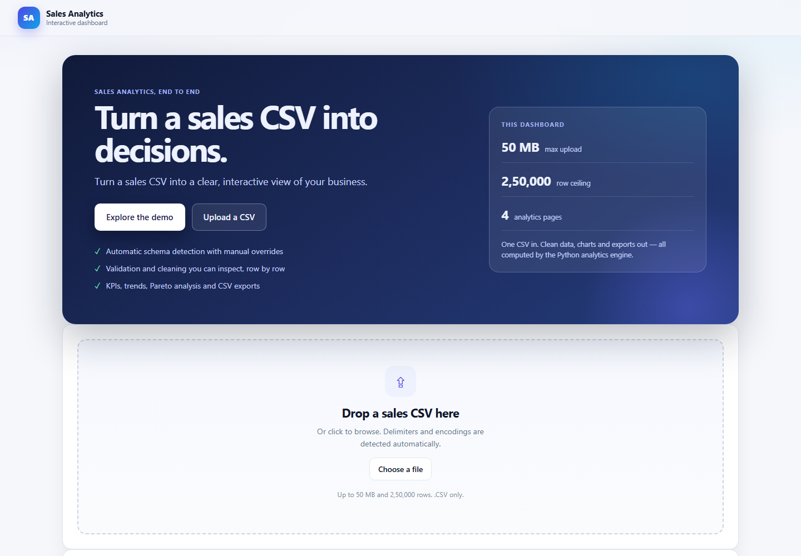
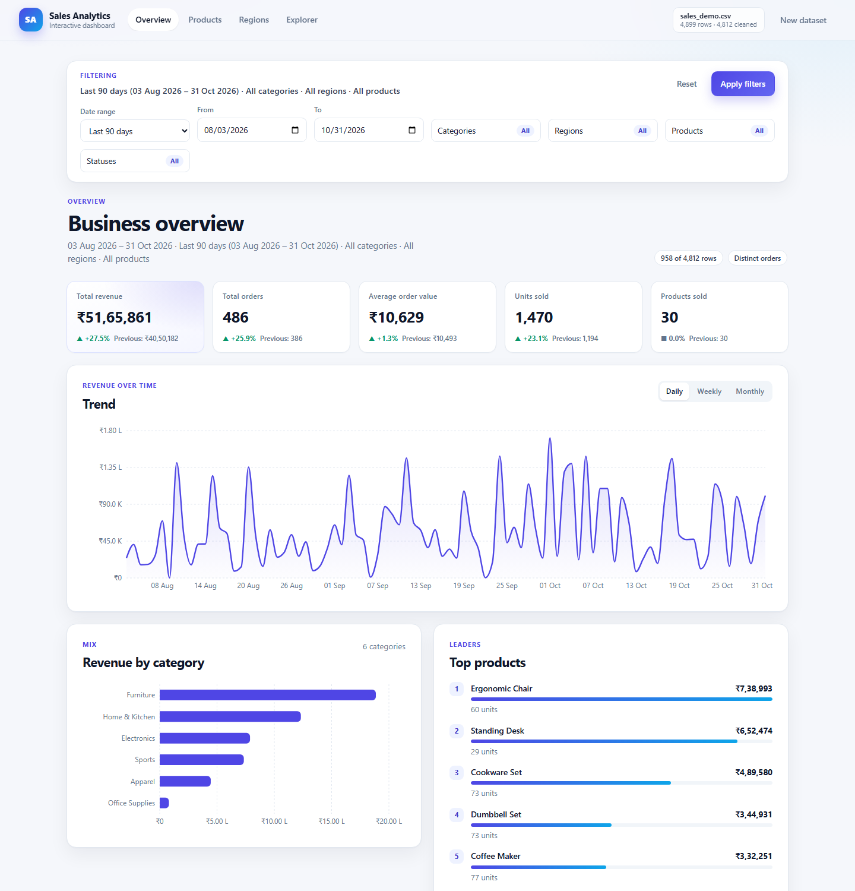
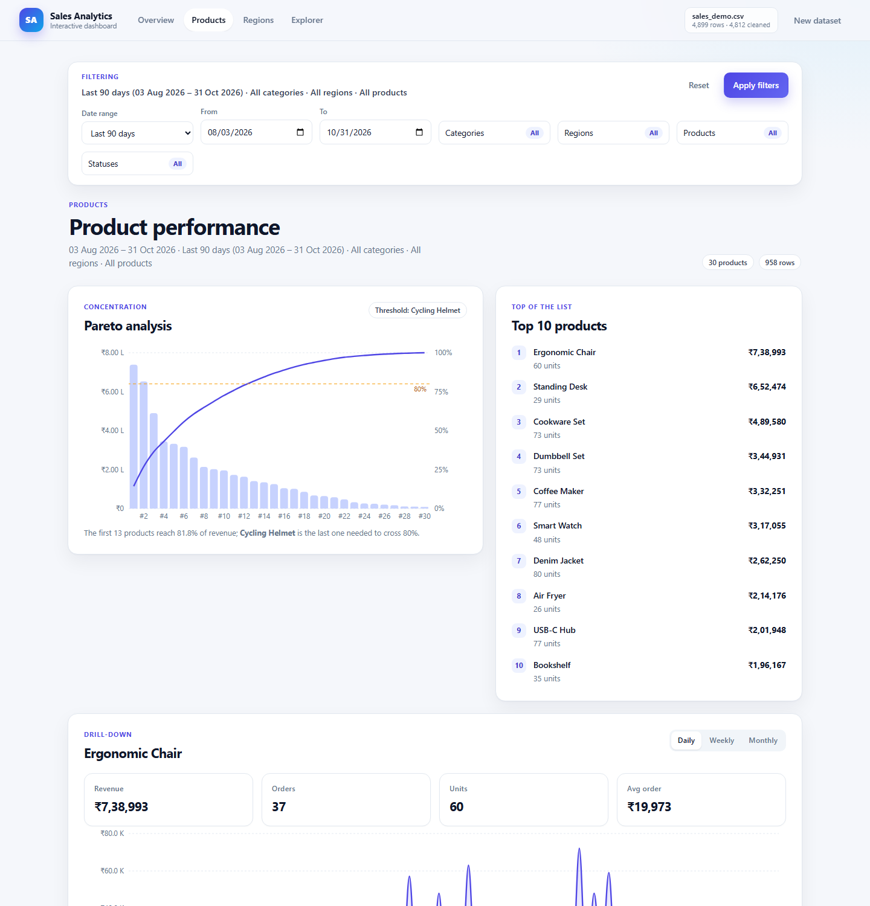
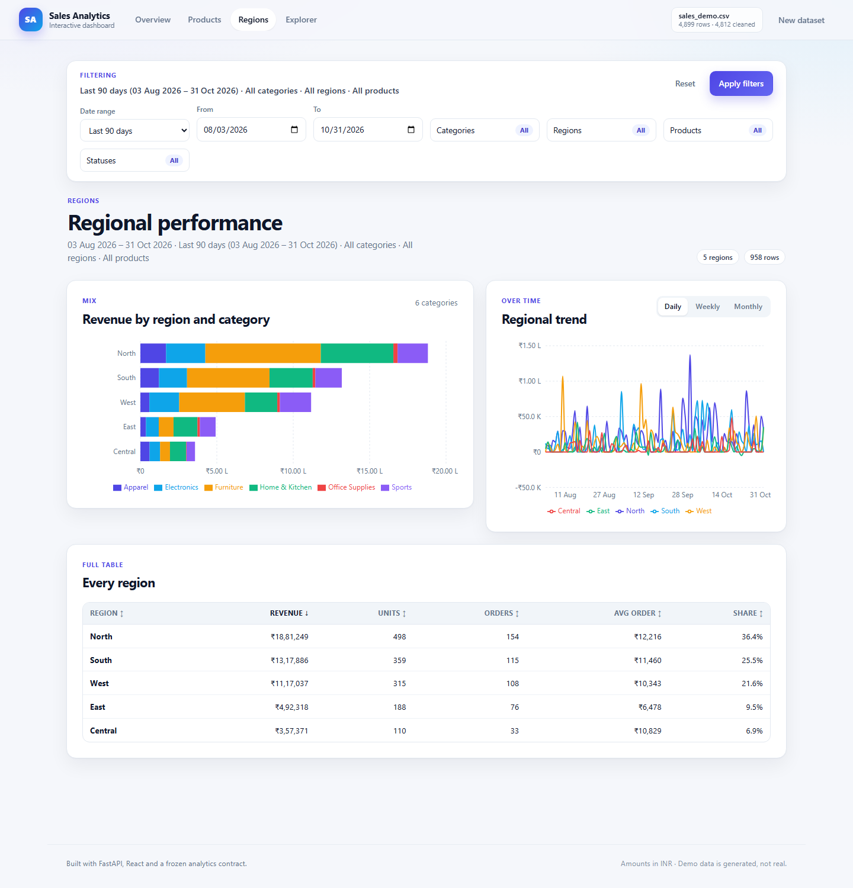
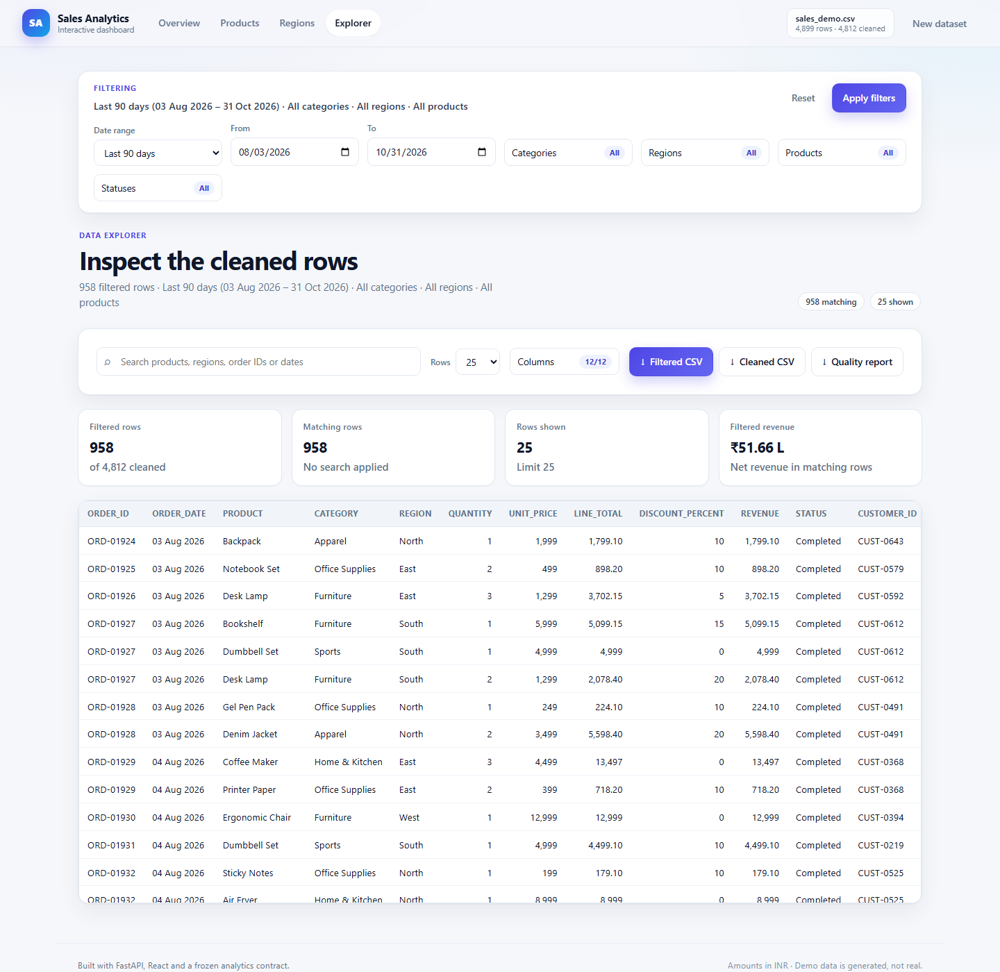
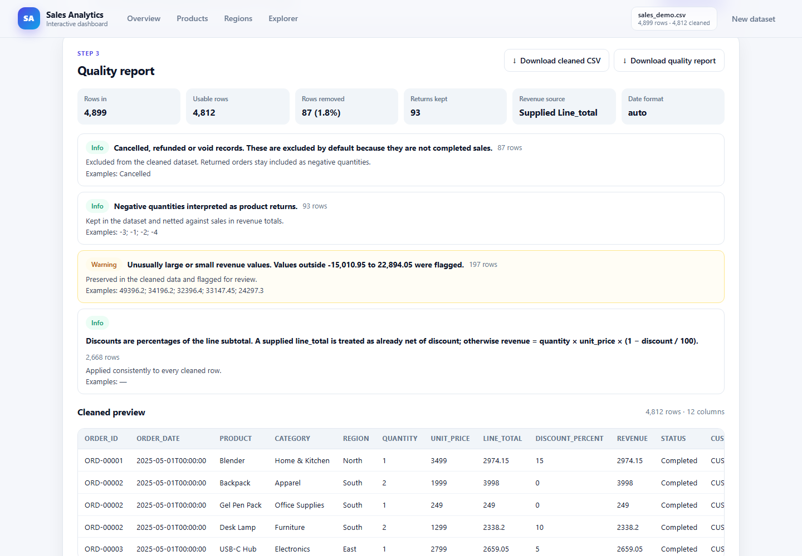

# Interactive Sales Analytics Dashboard

A portfolio-quality sales analytics application built with Python, FastAPI,
React, Pandas and Recharts. A business user can upload a sales CSV, validate
and clean it, explore interactive KPIs and charts, filter results, and download
the processed data.

**Current status:** v1.0.0 complete. The app is served by FastAPI with a React
19 + TypeScript frontend from a single origin. The original Streamlit interface
was removed in M14 once the React client reached parity, so the repository now
contains one production stack with no Streamlit or Plotly dependency.

## Overview

The app is designed for people who do not want to write code or wrestle with
spreadsheets. The application provides:

- A polished Home page with a clear product introduction.
- One-click loading of a bundled demo dataset.
- CSV upload with automatic encoding and delimiter detection, friendly errors,
  and the existing 50 MB / 250,000-row limits.
- Automatic detection of common column names and aliases, with a confidence
  indicator and a manual mapping override for uncertain matches.
- A structured validation report with severity, check code, description,
  affected row count, action taken and example values.
- Reusable cleaning functions for dates, numbers, text, duplicates, revenue,
  discounts, statuses, returns and outliers.
- A downloadable sample CSV and a complete column-format guide.
- An Overview dashboard with five KPI cards, period-over-period comparisons,
  interactive Recharts charts and deterministic business insights.
- A Products page with a sortable performance table, top-10 revenue ranking,
  Pareto analysis with an 80% threshold, and per-product drill-down.
- A Regions page with a regional performance table, revenue-by-region chart,
  category-by-region stacked bars and a multi-line regional revenue trend.
- A Data Explorer with global filters, case-insensitive search, column selection,
  row limits and sortable previews of the cleaned data.
- CSV downloads for the filtered view, the full cleaned dataset and the
  data-quality report, with Excel-friendly UTF-8 encoding.
- Shared filters for date presets and ranges, category, region, product and
  status. Selections persist across pages and reset when the dataset changes.
- A privacy note explaining that uploaded data is processed in memory only.

The demo dataset spans approximately 18 months and includes 30 products across
6 categories, 5 regions, multiple line items per order, discounts, cancellations
and returns.

## Screenshots

Captured from the running React app with the bundled demo dataset.

| Home | Overview |
|---|---|
|  |  |

| Products | Regions |
|---|---|
|  |  |

| Data Explorer and exports | Data-quality report |
|---|---|
|  |  |

## Technology stack

| Layer | Technology |
|---|---|
| Language | Python 3.11+; Node 24 for the frontend build |
| UI | React 19, TypeScript, React Router, Recharts |
| API | FastAPI, Uvicorn |
| Data processing | Pandas, NumPy |
| Visualisation | Recharts |
| Testing and linting | pytest, Ruff; Vitest, Testing Library, oxlint |
| CI and packaging | GitHub Actions, Docker |

The API is documented in [docs/API.md](docs/API.md), the decision record is
[ADR-001](docs/ADR-001-react-fastapi-migration.md), and the frontend has its own
[README](frontend/README.md). Production runs from a single container on port
8000; [docs/DEPLOYMENT.md](docs/DEPLOYMENT.md) covers configuration and hosting.

## Architecture

```text
CSV upload / demo file
        │
        ▼
loading.py      encoding, delimiter and size checks
        │
        ▼
schema.py       column detection, aliases, confidence, manual overrides
        │
        ▼
validation.py   issues with severity, affected rows and examples
        │
        ▼
cleaning.py     typed canonical columns, revenue, discounts, returns
        │
        ▼
filters.py      one shared FilterState for every page
        │
        ├──▶ analytics.py ──▶ page_payloads.py  (Overview, Products, Regions)
        └──▶ explorer.py  ──▶ exports.py        (Data Explorer, downloads)
        │
        ▼
src/sales_api/  JSON and CSV over HTTP, then the React client
```

Design choices:

- Business logic lives in pure functions (`analytics.py`, `filters.py`,
  `cleaning.py`, `explorer.py`, `exports.py`) with no web or UI imports. The API
  turns their results into payloads, and the React client only formats and
  renders those payloads.
- Every page reads the same cleaned dataframe and applies the same
  `FilterState`, so a filter set on Overview changes Products, Regions and the
  Data Explorer identically.
- Session state is limited to the loaded file, the cleaned result and the shared
  filter store, held by the process-local API session store. Uploaded bytes are
  never written to disk.
- The app fails closed: a blocked cleaning result hides the analytical routes,
  missing optional columns explain themselves, and an unexpected page error
  shows a friendly retry screen instead of a traceback.

## Quickstart (Windows PowerShell)

Build the production stack and serve it from one process:

```powershell
cd path\to\Interactive-sales-analytics-dashboard
python -m venv .venv
.\.venv\Scripts\Activate.ps1
python -m pip install --upgrade pip
python -m pip install -r requirements-dev.txt

cd frontend
npm ci
npm run build
cd ..

$env:PYTHONPATH = "src"
$env:SALES_API_STATIC_DIR = "frontend/dist"
python -m sales_api
```

Open <http://localhost:8000>. FastAPI serves the API and the built React client
on the same origin. `frontend/dist` is detected automatically when it exists, so
the last environment variable is optional.

On macOS or Linux, create the environment with `python3 -m venv .venv` and
activate it with `source .venv/bin/activate`.

If PowerShell blocks virtual-environment activation, allow it for the current
terminal session only:

```powershell
Set-ExecutionPolicy -Scope Process -ExecutionPolicy Bypass
.\.venv\Scripts\Activate.ps1
```

`requirements.txt` contains the runtime dependencies; `requirements-dev.txt`
adds the test and lint tools used above.

The entry point adds `src/` to the import path automatically, so an editable
install is optional. To install the package itself for development:

```powershell
python -m pip install -e .
```

## Frontend development

The React client talks only to the FastAPI backend. For hot reload, run the two
processes in separate terminals.

API:

```powershell
$env:PYTHONPATH = "src"
python -m sales_api
```

Frontend:

```powershell
cd frontend
npm install
npm run dev
```

Open <http://localhost:5173>. Vite proxies `/api` to `127.0.0.1:8000`, so no
CORS configuration is needed in development. The frontend tests and production
build run with `npm test` and `npm run build`; see
[frontend/README.md](frontend/README.md) for details. To exercise the production
single-origin path locally, follow the Quickstart above or
[docs/DEPLOYMENT.md](docs/DEPLOYMENT.md).

## Using the app

These steps describe the production React interface.

1. Start the production app with `python -m sales_api` after building the
   frontend, or run the Vite dev server alongside the API.
2. Click **Load demo dataset** to explore without a file, or upload a CSV.
3. Review the dataset overview and raw preview.
4. Check the **Schema detection** table. If a required field is missing or a
   match is low-confidence, open **Review or override column mapping**, choose
   the correct source columns and click **Apply mapping**.
5. If the file contains ambiguous dates such as `03/04/2026`, choose **Day first
   (DMY)** or **Month first (MDY)**. The app does not guess.
6. Click **Validate and clean data**.
7. Review the **Data-quality report**, including any prominent warning when more
   than 20% of rows were removed. Analysis is blocked when no usable rows remain.
8. Open **Overview** in the sidebar. The dashboard appears only after a valid
   cleaned dataset exists.
9. Use the shared sidebar filters to change the date preset or range, category,
   region, product or status. Filters persist across pages and reset when a new
   dataset is loaded.
10. Open **Products** to sort product performance, inspect the top-10 ranking and
    Pareto analysis, and drill into one product's revenue trend.
11. Open **Regions** to compare regional performance, category mix and regional
    revenue trends.
12. Open **Data Explorer** to search the filtered rows, choose preview columns,
    limit the table rows and download the matching data.
13. Switch the revenue trend between daily, weekly and monthly aggregation, then
    hover, zoom or pan any chart.
14. Download the cleaned dataset or data-quality report from the Home page, or
    grab filtered and full exports from the Data Explorer.
15. Use **Download sample CSV** to see the expected format.
16. Use **Clear loaded dataset** to remove the file and cleaning result from the
    current session.

### Dashboard metrics

The Overview page calculates every metric from the same filtered rows:

| Metric | Definition |
|---|---|
| Total revenue | Sum of net revenue, after discounts and returns |
| Total orders | Distinct non-empty `order_id` values; blank IDs count individually. Without `order_id`, each row is one order. |
| Average order value | Total revenue ÷ total orders (zero when there are no orders) |
| Total units sold | Sum of `quantity`, including negative returns |
| Total products | Distinct non-empty product names |

Every KPI is compared with the immediately preceding period of equal length.
The comparison period is shown under each card. Absolute and percentage changes
are displayed; when the previous value is zero, the percentage is shown as
unavailable instead of dividing by zero. For an all-time selection, the previous
period usually predates the dataset and the cards say so explicitly.

Date presets are anchored to the dataset's maximum date rather than today's
date. The default is the last 90 days so a comparison period normally exists.

### Products analytics

The Products page uses the same filtered rows as the Overview:

| Element | Behaviour |
|---|---|
| Product performance | Revenue, units sold, distinct orders, average order value and revenue share per product, sorted by revenue by default. |
| Revenue share | Product revenue ÷ total net revenue. When total net revenue is zero or negative, share is shown as unavailable instead of a misleading percentage. |
| Top 10 products | The ten highest-revenue products in an interactive bar chart. |
| Pareto analysis | Positive-revenue products ranked from highest to lowest, with cumulative revenue share and the first product that reaches 80%. Return-only products are excluded so the cumulative line ends at 100%. |
| Product drill-down | Revenue, units, orders and AOV for the selected product, plus a daily, weekly or monthly revenue trend. |

### Regions analytics

| Element | Behaviour |
|---|---|
| Regional performance | Revenue, orders, units, average order value and revenue share by region, sorted by revenue by default. |
| Revenue by region | Horizontal bar chart ranked by net revenue. |
| Category mix by region | Stacked bars showing each category's revenue within every region. |
| Regional revenue trend | Multi-line revenue trend with missing periods filled with zero so lines stay continuous. |

Blank regions are grouped as **Unknown region** and blank categories as
**Uncategorised**. If the cleaned dataset has no `region` column, the Regions
page explains that the analysis is unavailable rather than failing. Empty
filtered selections show friendly empty states on every table and chart.

### Data Explorer and exports

The Data Explorer uses the same globally filtered rows as every other page and
adds page-local controls:

| Element | Behaviour |
|---|---|
| Search | Case-insensitive literal search across text and date columns. Matching rows update immediately. |
| Columns to preview | Any subset of cleaned columns, in the order shown. This only affects the table preview. |
| Rows to display | 25, 50, 100, 250, 500 or all matching rows. The preview is capped by default to keep the page responsive. |
| Filtered data download | Every row matching the current global filters and search, with all cleaned columns. |
| Full cleaned data download | The complete cleaned dataset, independent of filters and search. |
| Quality report download | Summary metrics plus every validation issue with severity, code, affected rows, action and examples. |

Exports are UTF-8 CSV files with a byte-order mark, so Excel opens Indian digit
grouping and non-ASCII product names correctly. Download filenames include the
source filename and a timestamp. The Home page also offers the cleaned dataset
and quality report immediately after cleaning.

## CSV format

Required columns:

| Column | Requirement | Notes |
|---|---|---|
| `order_date` | Required | Sale date; `YYYY-MM-DD` recommended |
| `product` | Required | Product or item name |
| `quantity` | Required | Units sold; negative values are returns |
| `unit_price` | One of `unit_price` / `line_total` | Price per unit |
| `line_total` | One of `unit_price` / `line_total` | Net amount for the line |

Recommended and optional columns:

| Column | Requirement | Notes |
|---|---|---|
| `order_id` | Recommended | Used to count distinct orders |
| `category` | Optional | Product category |
| `region` | Optional | Sales region or territory |
| `discount_percent` | Optional | Discount from 0 to 100 |
| `status` | Optional | e.g. Completed, Cancelled, Returned |
| `customer_id` | Optional | Customer identifier |

Common aliases are detected automatically. For example, `Date`, `Purchase Date`,
`Qty`, `Price`, `Amount`, `Territory` and `Product Name` are accepted. Matching is
case-insensitive and ignores spaces and punctuation. Classic Models headers such
as `ORDERNUMBER`, `ORDERDATE`, `PRODUCTNAME`, `PRODUCTLINE`, `QUANTITYORDERED`,
`PRICEEACH` and `SALES` are recognised too. Each detected field carries a
confidence score; low-confidence matches can be overridden manually on the Home
page. A column can only be mapped to one field.

### Dates and ambiguity

ISO dates (`2026-01-15`) are recommended. Day-first (`15/04/2026`) and
month-first (`04/15/2026`) dates are both supported. A value such as
`03/04/2026` is ambiguous: it could mean 3 April or 4 March. When such values are
present, the app asks for an explicit **DMY** or **MDY** decision instead of
guessing. Invalid or blank dates are reported and their rows are dropped.

### Cleaning rules

| Area | Behaviour |
|---|---|
| Duplicates | Exact duplicate rows are removed; the first copy is kept. Different products sharing an `order_id` remain as legitimate line items. |
| Missing required values | Rows missing `order_date`, `product`, `quantity` or usable revenue are dropped and reported. |
| Text | Whitespace is trimmed and category, region and status labels are standardised. |
| Status | `Cancelled`, `Refunded` and `Void` records are excluded by default when a status column exists. `Returned` stays in the data. |
| Returns | Negative quantities are preserved and netted against revenue. |
| Revenue | A supplied `line_total` is used when available; otherwise revenue is `quantity × unit_price × (1 − discount / 100)`. |
| Discounts | `discount_percent` is a percentage from 0 to 100. If every value is between 0 and 1, it is treated as a fraction (`0.10` = 10%). Out-of-range discounts are reported and use 0 for the calculation. |
| Outliers | Unusual quantity or revenue values are flagged and preserved, never removed silently. |
| Missing `order_id` | Each row is counted as one order, and the report explains this. |

If more than 20% of rows are removed, the report shows a prominent warning. If no
usable rows remain, analysis is blocked with an explanation.

## Project structure

```text
.
├── src/sales_dashboard/
│   ├── config.py
│   ├── models.py
│   ├── schema.py
│   ├── dates.py
│   ├── parsing.py
│   ├── profiling.py
│   ├── loading.py
│   ├── validation.py
│   ├── cleaning.py
│   ├── filters.py
│   ├── analytics.py
│   ├── explorer.py
│   ├── exports.py
│   ├── formatting.py
│   ├── demo.py
│   ├── payloads.py
│   └── page_payloads.py
├── src/sales_api/
│   ├── app.py
│   ├── dependencies.py
│   ├── errors.py
│   ├── filtering.py
│   ├── middleware.py
│   ├── responses.py
│   ├── schemas.py
│   ├── sessions.py
│   ├── settings.py
│   ├── static.py
│   ├── views.py
│   └── routers/
│       ├── datasets.py
│       ├── exports.py
│       ├── filters.py
│       ├── health.py
│       ├── pages.py
│       └── preparation.py
├── frontend/
│   ├── src/
│   │   ├── api/          typed client and wire types
│   │   ├── components/   shell, filters, charts, tables
│   │   ├── context/      session, cleaning and filter state
│   │   ├── lib/          formatting and payload hook
│   │   └── pages/        Home, Prepare, Overview, Products, Regions, Explorer
│   ├── dist/             production build (gitignored)
│   ├── index.html
│   ├── package.json
│   └── vite.config.ts
├── data/sample/sales_demo.csv
├── docs/
│   ├── ADR-001-react-fastapi-migration.md
│   ├── API.md
│   ├── DEPLOYMENT.md
│   └── screenshots/
├── tests/
│   ├── golden/
│   ├── parity_payloads.py
│   └── test_parity.py
├── .github/workflows/ci.yml
├── Dockerfile
├── requirements.txt
├── requirements-dev.txt
├── pyproject.toml
└── README.md
```

## Demo dataset

The demo CSV is committed at `data/sample/sales_demo.csv` and generated by a
seeded NumPy process. Regenerate it after changing the generator:

```powershell
$env:PYTHONPATH = "src"
python -m sales_dashboard.demo
```

If the package is installed in editable mode, the simpler command works:

```powershell
python -m sales_dashboard.demo
```

The dataset is deterministic: the same seed and date range always produce the
same rows.

## Tests and linting

```powershell
python -m pytest
python -m pytest --cov=sales_dashboard --cov=sales_api --cov-report=term-missing
python -m ruff check .
python -m ruff format --check .
```

Frontend checks:

```powershell
cd frontend
npm run lint
npm test
npm run build
```

The Python suite contains 302 tests. It covers the demo dataset, schema alias
detection and confidence, CSV loading and error handling, date ambiguity
decisions, validation checks, cleaning rules, profiling and INR formatting.
Dashboard coverage includes every KPI formula, distinct and fallback order
counting, zero-order AOV, period comparisons, max-date-anchored presets,
individual and combined filters, persistence and dataset-change reset,
daily/weekly/monthly trends, category and top-10 calculations and insight
generation. Products and Regions coverage includes product and regional
performance, revenue share, order counts and AOV, top-10 limits, Pareto
cumulative shares and the 80% threshold, zero and negative revenue, product
drill-down snapshots and trends, category-by-region aggregation, missing region
columns and empty filtered results. Data Explorer and export coverage includes
literal case-insensitive text and date search, empty searches, column
validation, UTF-8 BOM CSV round-trips, safe timestamped filenames,
quality-report summary and issue rows, page downloads and global-filter
consistency. Version tests keep the package, config and `pyproject.toml` in
sync. The API tests cover the session store (expiry, capacity, isolation),
dataset creation from the demo and uploads, manual mapping, date inspection,
cleaning and its ambiguity stop, filter resolution, all four page payloads for
the default, narrow and zero-row selections, the three CSV downloads with their
frozen filenames and hashes, the shared error envelope, response normalisation,
CORS configuration, metadata and the module entrypoint. Static-serving coverage
includes the SPA shell and client-route fallback, immutable asset caching, JSON
404s for `/api` and `/exports`, gzip, security headers and the docs toggle.
The frontend suite adds 26 Vitest tests for INR and Indian digit grouping,
date/range labels, download filename parsing, the error envelope, network and
abort handling, and KPI card states. oxlint checks the React and TypeScript
sources, and the production build runs under strict TypeScript.
The GitHub Actions workflow runs linting, formatting checks and tests with a
coverage report on Python 3.11 and 3.12, a Node 24 job that installs, lints,
tests and builds the frontend, and a container job that builds the production
image and smoke-tests the served SPA, API, gzip and cache headers.

### Frozen analytics contract

`tests/parity_payloads.py` and `tests/test_parity.py` freeze the domain layer's
output as golden files in `tests/golden/`. Each file records one scenario's
loaded profile, detected mapping, date inspection, validation and cleaning
report, every page payload for the default, narrowed and empty filter states,
and the exact bytes (size and SHA-256) of each export. Eight scenarios are
frozen: the demo dataset, a classic-models file with manual overrides, missing
order IDs, missing regions, ambiguous dates, returns-only data, a messy file and
an incomplete mapping.

The payloads are built from `sales_dashboard` alone — no HTTP, database or UI
framework — so the fixtures describe the analytics contract rather than the
current client. The page builders live in `sales_dashboard.page_payloads`, which
the API also calls, so the fixtures and the routes share one implementation. A
change to any number, label, ordering or CSV byte fails with the first differing
JSON path. Regenerate only after an intentional behaviour change:

```powershell
python -m pytest tests/test_parity.py --update-golden
```

## Deployment

The production app is one container on port 8000. FastAPI serves the API and the
built React client from the same origin:

```powershell
docker build -t sales-dashboard .
docker run --rm -p 8000:8000 sales-dashboard
```

The multi-stage image builds `frontend/dist` with Node 24, installs only the
runtime requirements, runs as a non-root user and checks `/api/health`. For a
local production build without Docker, build the frontend and run
`python -m sales_api` with `SALES_API_STATIC_DIR=frontend/dist`.

Sessions are process-local, so deploy one worker and one instance; restarting
the container ends active sessions. For environment variables, platform
checklists, session limits and troubleshooting, see
[docs/DEPLOYMENT.md](docs/DEPLOYMENT.md).

## Data privacy

Uploaded CSVs are processed in memory for the current API session.
The application does not save uploaded files, log their contents, or send them
to a third-party service. Replacing or clearing the dataset removes it from the
session. As with any hosted application, the server running the app receives
the uploaded bytes while the session is active. The React client stores only an
opaque session id in `sessionStorage`.

## Roadmap

- **M1 (complete):** scaffold, demo dataset and Home page.
- **M2 (complete):** validation, cleaning, manual column mapping and data-quality report.
- **M3 (complete):** business metrics, global filters and Overview page.
- **M4 (complete):** Products and Regions analytics pages.
- **M5 (complete):** Data Explorer, CSV exports and quality-report downloads.
- **M6 (complete):** error boundary, loading spinners, accessibility and chart
  polish, screenshots, deployment guide, Dockerfile, coverage reporting and
  v1.0.0 release.
- **M7 (complete):** frozen analytics contract (golden fixtures) ahead of the
  React + FastAPI migration. See
  [ADR-001](docs/ADR-001-react-fastapi-migration.md).
- **M8 (complete):** FastAPI skeleton with a shared error envelope, metadata,
  an in-memory idle-expiring session store and the dataset lifecycle endpoints.
  See [docs/API.md](docs/API.md).
- **M9 (complete):** manual mapping, date inspection, cleaning with the
  ambiguity stop, and filter defaults/resolution — each tied to the frozen
  golden files.
- **M10 (complete):** page payload builders promoted into the domain package and
  Overview, Products, Regions and Explorer endpoints returning the frozen
  `pages.*` bodies, with explorer search and preview limits.
- **M11 (complete):** cleaned, filtered and quality-report CSV downloads, with
  filenames, sizes and SHA-256 tied to the frozen export contract.
- **M12 (complete):** React 19 + TypeScript frontend with all five flows,
  session restore, Recharts charts, responsive styling, client-side tests,
  lazy-loaded analytics routes and a Node CI job.
- **M13 (complete):** single-origin production serving. FastAPI serves the built
  React SPA with client-route fallback, immutable asset caching, gzip and
  security headers; a multi-stage Docker image builds the client and runs the
  API on port 8000; CI builds the image and smoke-tests the production surface;
  deployment documentation rewritten for the new stack.
- **M14 (complete):** removed the Streamlit interface, its page and UI modules,
  the Plotly chart builders and their tests; consolidated the runtime
  requirements, updated package metadata and documentation, and regenerated the
  screenshots from the React app.

## License

Released under the MIT License. See [LICENSE](LICENSE).
